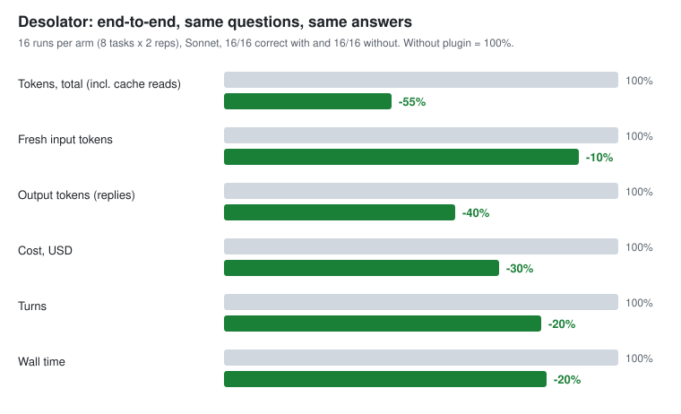

# Desolator

Token and cost saver for Claude Code. Every turn re-reads the whole context, so the plugin cuts what enters it: unused tool schemas, whole-file reads, long logs, broad searches.

## Benchmark: bare Claude Code vs. Desolator (end to end)



Same 8 code-reading questions on Django, Flask and requests (public repos), Sonnet, 2 repetitions each, alternating arm order: 32 `claude -p` runs. All 16 answers are correct in both arms. Arm "with plugin" = this plugin + `slim.py code`.

| Parameter | Without plugin | With plugin | Saved (exact) | Chart (rounded to 5%) |
|---|---|---|---|---|
| Tokens, total (incl. cache reads) | 1,744,493 | 741,442 | 57% | -55% |
| Fresh input tokens | 155,560 | 139,899 | 10% | -10% |
| Output tokens (replies) | 21,340 | 12,526 | 41% | -40% |
| **Cost** | **$1.15** | **$0.80** | **30%** | **-30%** |
| Turns | 72 | 58 | 19% | -20% |
| Wall time | 295 s | 242 s | 18% | -20% |

Read it like this:
- Cost is the number that matters. Most of the token saving is cache reads, which are billed at about a tenth of the normal price, so -57% tokens becomes -30% money.
- Where it comes from (separate measurements): `slim` removes tool schemas that were re-sent every turn (about -56% tokens, -15% cost); the one-line reply style cuts reply tokens by about a third; the grep hint avoids a wasted turn. `ask.py` itself did not move the end-to-end numbers: the agent rarely calls it, and its built-in Grep is already good enough on small and medium repos.
- Scope: read-only code questions, one model, three repos, 16 runs per arm. Run-to-run spread of the same task is about 12% on cost, so single numbers are approximate. Sessions that edit files will save less.
- Reproduce: `python bench/setup_e2e.py && python bench/e2e.py --reps 2 && python bench/make_chart.py bench/results/*.jsonl` (about 2.5M tokens). Raw runs: [bench/results/run.jsonl](bench/results/run.jsonl).

## Install
```
claude plugin marketplace add Lemxy/DesolatorPlugin
claude plugin install desolator@desolator
```
Local checkout: `claude --plugin-dir <path>`. Requires Python on PATH (`python`).
Full guide (setup per project, settings, update, removal): [INSTALL.md](INSTALL.md).

## Parts

### Hooks (on by default)
- `context_guard.py` (UserPromptSubmit): warns once per 50k step when the session context passes 150k (`DESOLATOR_CTX_WARN`). Long sessions are most of real token use.
- `write_guard.py` (PreToolUse Write): blocks full rewrites of existing files over 20 KB (`DESOLATOR_WRITE_MAX`, bypass `DESOLATOR_ALLOW_BIG_WRITE=1`). Edit sends only the change.
- `read_guard.py` (PreToolUse Read): blocks whole reads of files over 40 KB (`DESOLATOR_READ_MAX`, bypass `DESOLATOR_ALLOW_BIG_READ=1`). Grep, then Read with offset/limit.
- `grep_route.py` (PreToolUse Grep): in a repo with a graphify graph or over 30 code files, the first broad repo-wide Grep (`word` or `a|b`) still runs, with a one-line ask.py hint attached (a deny cost a full turn whenever the agent repeated the grep). Regex and file/glob/type-scoped greps get no hint. Off: `DESOLATOR_GREP_ROUTE=0`.
- `bash_trim.py` (PreToolUse Bash): build/test/install output over 120 lines -> first 40 + last 80 lines, full log in a temp file, exit code kept. Only in bypassPermissions mode or with `DESOLATOR_BASH_TRIM=1`: the wrapper breaks allowlist matching, so normal modes would prompt. Piped, chained or background commands pass.
- `route_context.py` (SessionStart): always one reply-style line (answer first, 1-3 sentences, no recap; reply tokens are the priciest, `DESOLATOR_TERSE=0` turns it off), then one-line hints only when they apply (code graph, `ProjectMap/`, big repo (ask.py indexes it itself), markdown over 20 KB). Projects without these pay for the style line only.

### Tools
- `slim.py` / `/desolator:slim`: hides tools a coding session does not need (Artifact, Cron, Worktree, ...) via `permissions.deny`. WebSearch/WebFetch stay. `python slim.py` (this project), `--user` (all projects), `core` (also hides Agent/Task/TodoWrite), `--scan` (asks Haiku once for the real tool list, hides extra tools and MCP servers), `--undo`, `--dry-run`.
- `ask.py`: natural-language code search. No dependencies: `indexer.py` builds the symbol/call graph itself (Python via `ast`, JS/TS/Rust/Go/Java/C#/Ruby/PHP/Kotlin/Swift/C by regex), cached in the temp dir and refreshed when a file changes. A graphify `graphify-out/graph.json` is used if present (`--own` ignores it). The agent supplies keywords (`--kw`); that is what makes recall work. Optional `<repo>/synonyms.json` (`{"word": ["syn"]}`).
- `mapsplit.py` + `ask.py --map`: split a big markdown map into cards (`ProjectMap/` + `INDEX.md`), then fetch only matching sections.
- `stats.py`: where the tokens went in the last sessions of a project (peak context, cache reads/writes, output, tool results by size).

### Skills and agents
- `skills/route`: find code with ask.py, delegate bulk mechanical edits to `scout`.
- `skills/rules`: code rules (comments why-only, max 8 words; no duplicates; rule of three).
- `agents/scout.md` (Haiku): bulk mechanical edits and log summaries, never logic.

## Measured
On a private Tauri + Node monorepo (~600 source files), Sonnet:
- slim, read-only question, same correct answer: 169k -> 82k raw tokens (-52%), cache-weighted -29%. Base context per turn 33.9k -> 15.1k.
- ask + agent keywords: recall 0.78-0.82 on 60 blind questions, ~200 tokens per answer. Without graphify edges (declarations only): 0.72.
- `bench_ask.py` (reproducible, public code): question = first sentence of a docstring/JSDoc, target = its file; the target's own comment is removed from the text index and the symbol name from the question. Recall@12 / MRR, ask top 12, rarest-question-words as keywords:

  | corpus (questions) | graphify | built-in index | text only |
  |---|---|---|---|
  | Python stdlib, 555 files (150) | 0.76 / 0.41 | 0.70 / 0.40 | 0.76 / 0.42 |
  | pdf-lib TS source, 139 files (40) | 0.53 / 0.21 | 0.60 / 0.27 | 0.55 / 0.24 |
  | universal-modder Python, 154 files (9) | 0.89 / 0.57 | 0.89 / 0.53 | 0.89 / 0.57 |

  The built-in index matches graphify within noise (+-0.06) with no install. On this question type the graph adds nothing over the text index; its value is the `symbol@line` pointers. Cost per answer: ~105 tokens (built-in) vs ~54 (graphify). Latency: built-in index 0.1-3 s once (cached after), graphify graph load 0.15 s. Questions here are synthetic; the 60 human questions above are the closer proxy.
- ask vs reading the relevant files: ~420 vs ~18.6k tokens for 3 questions. The answer is pointers, so a few slices still get read.
- `ask.py --map` on a 60 KB project map: fact found 7/8, ~820 tokens per answer vs ~10-20k for the whole file.
- Doc style, one section, real tokenizer: prose RU 794, terse RU 397, terse EN 368 tokens. Terseness saves ~50%, language ~7%.
- Reasoning language (EN vs RU), 10 runs: no stable cost difference; tool calls dominate output.
- Sonnet with ask: 3-9% fewer tokens on 12 of 12 easy bugs.

Numbers above are per mechanism, measured on other corpora. The end-to-end result for the whole plugin is at the top of this file.
